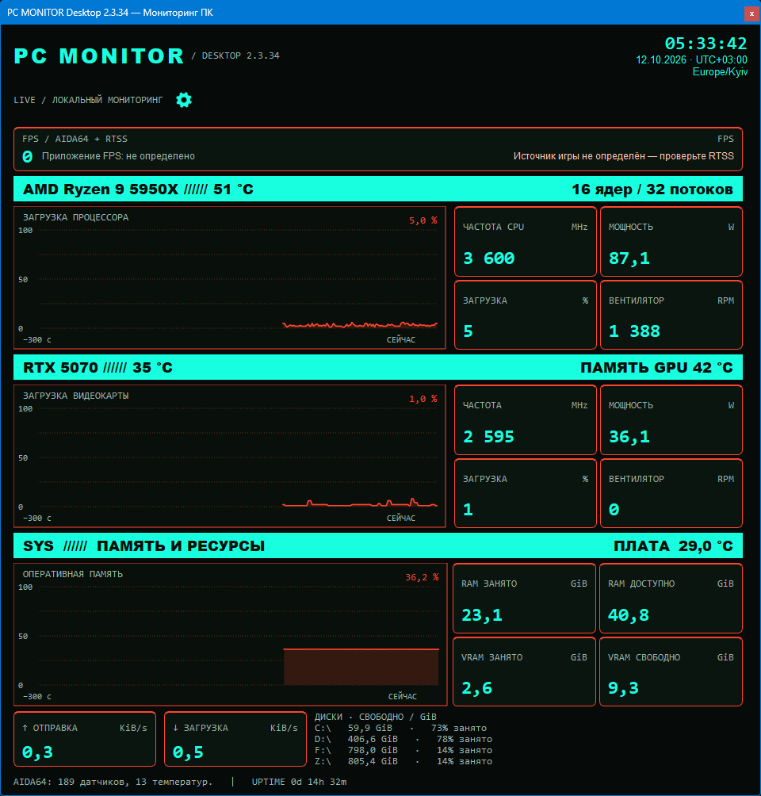
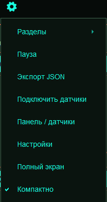
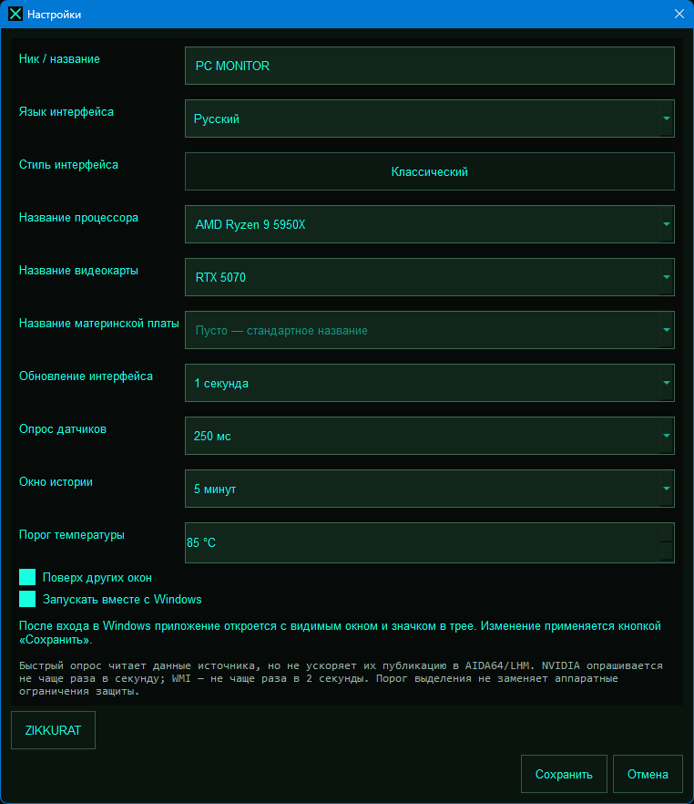
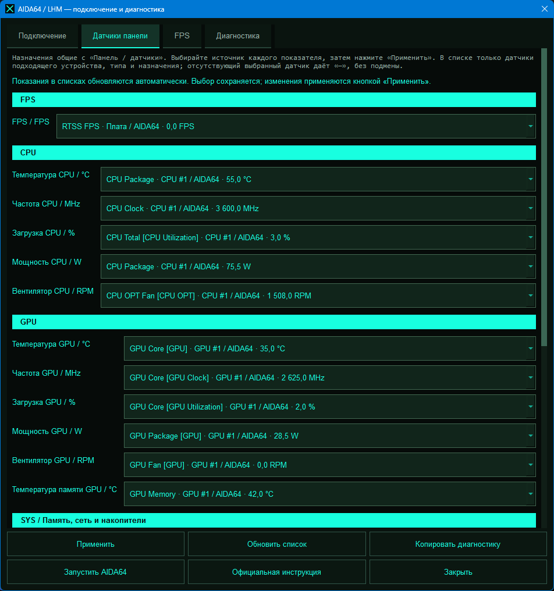
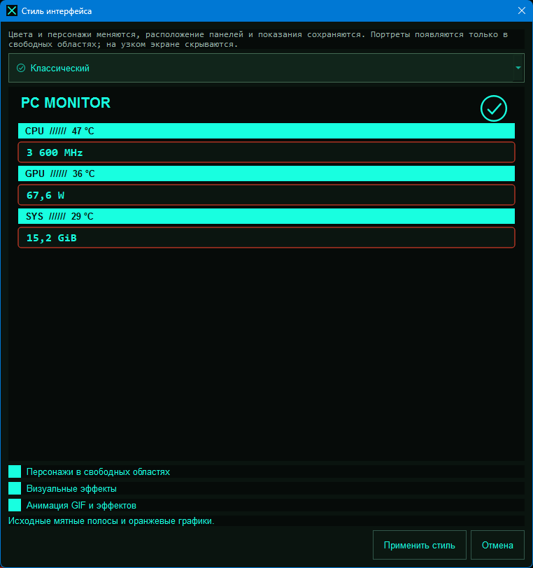

# PC Monitor

**Версия 2.3.34 · Windows 10/11 x64 · Разработчик — ZIKKURAT**

Нативная программа для локального мониторинга компьютера: процессор, видеокарта, температуры, память, сеть, диски и FPS. Настраиваемые карточки, русский/украинский/английский интерфейс, цветовые и аниме-темы, GIF-персонажи и визуальные эффекты.

**[Скачать выпуск](https://github.com/ZIKKURAToffc/PC-Monitor/releases)** · [Подробная установка](docs/INSTALL.md) · [Руководство пользователя](docs/USAGE.md) · [Все параметры](docs/PARAMETERS.md) · [Решение проблем](docs/TROUBLESHOOTING.md)

> **Важно:** обычный `build_windows.bat` после успешной сборки и установки EXE **удаляет всю распакованную папку исходников**. ZIP и личные файлы храните вне неё. Для Git-клона и разработки используйте **`build_windows.bat --keep-sources`**.

## Возможности

- **CPU:** температура, частота, загрузка, мощность, обороты вентилятора и график загрузки.
- **GPU:** основная температура, температура видеопамяти, частота ядра, загрузка, мощность и вентилятор.
- **Система:** температура материнской платы, занятая/доступная RAM и VRAM, сеть и свободное место на дисках.
- **FPS:** чтение опубликованного показания, в том числе AIDA64/RTSS, и имени приложения из доступных метаданных RTSS.
- **Настройка панели:** выбор совместимого источника, изменение подписи, скрытие показателя и до 128 собственных карточек.
- **Оформление:** 10 тем, 16 персонажей; отдельное отключение персонажей, эффектов и анимации.
- **Окно:** сохранение положения/размера, перетаскивание за шапку, полный экран без рамки, режим поверх других окон и трей.
- **Дополнительно:** добровольный автозапуск после входа Windows, экспорт JSON, диагностика и локальный журнал ошибок.

Наличие конкретного датчика зависит от оборудования, драйверов и внешнего источника. Программа не управляет охлаждением, напряжением или разгоном и не отправляет телеметрию.

## Скриншоты

### Главная панель

Локальные показания CPU/GPU, память, сеть и диски. Значения на снимке — пример, а не гарантированные показания для любого ПК. FPS = 0 означает, что источник передал ноль; это не расчёт по загрузке GPU.



### Меню управления

Все основные действия находятся в меню шестерёнки: разделы, пауза, экспорт, подключение датчиков, настройка панели, общий конфиг, полный экран и компактный режим.



### Общие настройки

Язык, названия оборудования, оформление, интервалы обновления, история, порог температуры, Topmost и автозапуск.



### Датчики панели

Выбор источника каждого показателя. Списки обновляются автоматически; изменения применяются кнопкой **Применить**.



### Выбор стиля

Предпросмотр оформления и переключатели персонажей, эффектов и анимации. Числа в предпросмотре стиля — демонстрационные, не текущие аппаратные измерения.



## Что требуется для корректной работы

| Что установить | Когда требуется |
|---|---|
| **Windows 10/11 x64** | Основная платформа готового EXE. |
| **Драйверы чипсета/материнской платы и видеокарты** | Используйте подходящие актуальные драйверы производителя оборудования. |
| **AIDA64 Extreme или LibreHardwareMonitor** | Источник аппаратных температур, мощности и вентиляторов. Для этих показаний оба одновременно не обязательны. |
| **RTSS + экспорт FPS в AIDA64** | Стандартный путь отображения FPS в играх для этой версии. |
| **Python 3.10+ x64 и интернет** | Только для сборки/запуска исходников. Для готового EXE Python не нужен. |

Основные данные ОС — загрузка CPU, RAM, сеть и свободное место — собираются программой через psutil. Темы, GIF и необходимые Python/Qt-библиотеки входят в собранный EXE. **AIDA64/LHM/RTSS и драйверы в EXE не входят** и устанавливаются отдельно.

**MSI Afterburner не является обязательным требованием PC Monitor.** Если RTSS установлен вместе с ним, для FPS важны работа самого RTSS и экспорт в AIDA64.

Внешние источники должны оставаться запущенными. Автозапуск PC Monitor не запускает AIDA64/LHM/RTSS за пользователя.

## Установка

### Вариант 1 — готовый EXE

1. Откройте **[Releases](https://github.com/ZIKKURAToffc/PC-Monitor/releases)** и выберите нужную версию.
2. Скачайте прикреплённый **PC-Monitor.exe** из **Assets**, если автор его опубликовал. **Source code (zip)** — исходники, не готовый установщик.
3. Поместите EXE в постоянную папку, например `D:\PC-Monitor\PC-Monitor.exe`.
4. Запустите двойным щелчком и настройте источник через **⚙ → Подключить датчики**.

Python и компиляция не нужны. Не запускайте файл из самого ZIP. Для распаковки встроенных onefile-ресурсов программа использует системный TEMP, поэтому доступ к нему необходим. Ярлык после скачивания отдельного EXE можно создать вручную: сам EXE его не создаёт.

### Вариант 2 — сборка и установка через BAT

1. Скачайте **Source code (zip)** из Release либо исходники через **Code → Download ZIP**.
2. Установите **Python 3.10+ x64**, включив **Add Python to PATH**. Рекомендован Python 3.13, с которым проверялись тесты.
3. Сохраните ZIP вне будущей папки исходников.
4. Распакуйте проект отдельно, например в `D:\Downloads\PC-Monitor-2.3.34`.
5. Откройте распакованную папку и запустите **build_windows.bat**.
6. Дождитесь окончания; интернет нужен для установки зависимостей.

Сценарий автоматически:

- создаёт временную среду Python;
- устанавливает зависимости и PyInstaller;
- собирает один **PC-Monitor.exe** с ресурсами;
- проверяет целостность копии перед заменой прежнего EXE;
- устанавливает файл в **`X:\PC-Monitor\PC-Monitor.exe`**, где X — диск проекта;
- создаёт или обновляет ярлык на рабочем столе текущего пользователя;
- очищает временные файлы сборки;
- после успешной обычной сборки **удаляет всю распакованную папку исходников**.

Например, проект на диске D: → **`D:\PC-Monitor\PC-Monitor.exe`**.

> **Не распаковывайте исходники прямо в `X:\PC-Monitor`: это папка назначения EXE. Всё внутри удаляемой source-папки — включая .git, старую .venv, помещённые туда архивы и личные файлы — может быть удалено. Сохраняйте резервные ZIP снаружи.**

При ошибке компиляции/копирования исходники и предыдущий установленный EXE сохраняются. Если Windows блокирует очистку, сценарий сообщает об этом; может остаться часть исходной папки. Ошибка создания ярлыка не отменяет успешную установку EXE.

Для записи в корень диска может понадобиться дополнительное право. При отказе доступа можно запустить доверенный BAT от администратора. Не отключайте антивирус или защиту ОС ради сборки. UNC/сетевой путь проекта не поддерживается: используйте локальный диск с буквой.

### Сборка с сохранением исходников

Откройте терминал в папке проекта и выполните:

```bat
build_windows.bat --keep-sources
```

EXE и ярлык будут созданы, временная среда очистится, но проект останется. **Для клонированного Git-репозитория используйте этот вариант**, иначе обычная успешная сборка удалит репозиторий вместе с `.git`.

### Запуск исходников без компиляции

**start_windows.bat** создаёт `.venv`, устанавливает зависимости и запускает программу из исходников. Этот способ не создаёт готовый onefile-EXE и не удаляет проект. Для сообщений консоли используйте **debug_windows.bat**.

Для демонстрации после установки зависимостей:

```bat
.venv\Scripts\python.exe desktop.py --demo
```

**DEMO — синтетические данные, не реальные датчики.**

## Подключение датчиков

### AIDA64 Extreme

Интеграция ориентирована на **AIDA64 Extreme 8.00.8000**. Другие выпуски требуют проверки совместимости экспорта; версия AIDA64 по XML не определяется. Используйте законно установленный источник.

1. Запустите AIDA64.
2. Откройте **Preferences → Hardware Monitoring → External Applications**.
3. Включите **Enable shared memory**.
4. Отметьте нужные температуры, частоты, загрузку, мощность и RPM.
5. Оставьте AIDA64 открытой.
6. В PC Monitor: **⚙ → Подключить датчики → AIDA64 Shared Memory → Применить**.
7. На вкладке **Датчики панели** назначьте показатели и нажмите **Применить**.

Порт и пароль для Shared Memory не нужны. При отказе доступа проверьте пользователя и уровни прав обеих программ, не отключая защиту.

### LibreHardwareMonitor

Официальный проект: **[LibreHardwareMonitor](https://github.com/LibreHardwareMonitor/LibreHardwareMonitor)**.

1. Запустите LHM и проверьте наличие датчиков в его окне.
2. Включите **Remote Web Server → Run**. Стандартный порт — **8085**.
3. В PC Monitor выберите **LHM: только HTTP** для новых версий.
4. Укажите порт и, если включена Authentication, пользователя/пароль.
5. Нажмите **Применить** и оставьте LHM запущенным.

Чтение только с `http://127.0.0.1:<порт>/data.json`, без proxy и HTTP-перенаправлений. Пароль используется в текущем сеансе, не сохраняется. Не открывайте сервер LHM в интернет. WMI предназначен для совместимых старых выпусков; в новых LHM используйте HTTP.

### FPS — RTSS и AIDA64

1. Запустите RTSS и игру. Профиль должен относиться к EXE игры, не только к лаунчеру; detection level не None.
2. Убедитесь, что RTSS сам показывает ненулевой FPS.
3. В AIDA64 включите Shared Memory и экспорт **RTSS FPS / SRTSSFPS**.
4. В **Датчики панели** выберите для FPS **Авто** либо подходящий **RTSS FPS** с единицей FPS.
5. Нажмите **Применить**, проверьте вкладку **FPS** и оставьте RTSS/AIDA64 запущенными.

LHM сам по себе не обеспечивает стандартный FPS-путь этой версии. Если RTSS показывает 0, PC Monitor не может восстановить отсутствующие кадры. Некоторые игры/античиты ограничивают мониторинг: не обходите ограничения, используйте разрешённый встроенный счётчик.

Имя приложения читается отдельно из RTSS. AIDA64 не подтверждает связь общего экспортированного FPS с конкретным PID; несколько активных приложений не приводят к случайному выбору одного имени. В подписи расширение `.exe` скрывается.

## Управление

| Действие | Как использовать |
|---|---|
| Открыть команды | Кнопка **⚙** рядом со строкой LIVE/DEMO. |
| Сменить раздел | **Разделы → Обзор ресурсов / Температуры / Все датчики**. |
| Пауза / продолжить | Меню или **Space**. Замораживается отображение; фоновый сбор может продолжаться. |
| Полный экран | Меню или **F11**; **Escape** возвращает обычное окно. |
| Переместить окно | В обычном режиме перетаскивайте за название, часы или свободную шапку. |
| Компактный режим | Пункт **Компактно** меняет плотность элементов, не данные. |
| Экспорт | **Экспорт JSON** сохраняет текущий отображаемый снимок и историю. |
| Настроить карточки | **Панель / датчики**: источник, подпись, скрытие и свои карточки. |
| Поднять окно из трея | Нажмите значок либо **Показать окно** в меню трея. |
| Завершить работу | Крестик окна или **Выход** в трее — это полное завершение, не скрытие окна. |

В Windows при доступном трее отдельная кнопка панели задач скрывается, но окно остаётся видимым. При недоступном трее используется обычное окно с панелью задач.

Положение и размер сохраняются автоматически. При отключении монитора окно возвращается в видимую область. Следующий запуск после закрытия в полном экране не включает полный экран автоматически.

## Основные настройки

В **⚙ → Настройки** изменения применяются кнопкой **Сохранить**.

| Параметр | Значения / стандарт | Назначение |
|---|---|---|
| Ник / название | До 48 символов; **PC MONITOR** | Подпись приложения. |
| Язык | Русский, Українська, English; **Русский** | Язык интерфейса, не часовой пояс. |
| Стиль | 10 тем; **Классический** | Открывает отдельное окно выбора оформления. |
| Названия CPU/GPU/платы | До 80 символов; пусто | Пользовательские подписи, не выбор оборудования. Имя платы заменяет SYS. |
| Обновление интерфейса | 250, **500**, 1000, 2000, 5000 мс | Перерисовка доступного снимка. |
| Опрос датчиков | 250, **500**, 1000, 2000, 3000, 5000 мс | Желаемая частота аппаратного чтения. |
| Окно истории | **60**, 120, 300 секунд | Видимый диапазон графиков. |
| Порог температуры | 30–120 °C; **85 °C** | Визуальное выделение, не аппаратная защита. |
| Поверх других окон | По умолчанию выключено | Режим Topmost. |
| Запускать вместе с Windows | По умолчанию выключено | Запуск готового EXE после входа текущего пользователя. |

Быстрый опрос не ускоряет публикацию AIDA64/LHM. NVIDIA опрашивается не чаще раза в секунду, WMI — не чаще раза в две секунды. Часы/дата/часовой пояс берутся из ОС; отдельного ручного выбора зоны нет.

Темы: **Классический, Арктический синий, Янтарный, Фиолетовый неон, Фрирен, Ван Пис, Ванпанчмен, Наруто, Тетрадь смерти, Атака титанов**. Персонажи, эффекты и анимация переключаются отдельно. Портреты скрываются при нехватке свободного места. **Применить стиль** сохраняет оформление отдельно: последующая отмена общих настроек не откатывает уже применённый стиль.

Полное описание всех **21 стандартного назначения**, единиц, источников, собственных карточек, тем и аргументов запуска — в **[docs/PARAMETERS.md](docs/PARAMETERS.md)**.

## Автозапуск, обновление и удаление

Автозапуск включается только в готовом Windows EXE через настройки и **Сохранить**. Он не включается самой сборкой и не запускает внешние источники. После переноса EXE повторно сохраните включённый автозапуск из новой папки.

Перед обновлением полностью закройте монитор. Замените EXE в постоянной папке; настройки и положение хранятся отдельно от исходников. Перед удалением отключите автозапуск, затем удалите EXE и ярлык.

## Если что-то не работает

- **«—»** — датчик недоступен/несовместим; **0** — опубликованный ноль. 0 RPM может быть штатным Fan Stop.
- Выбранный пропавший датчик не заменяется автоматически; выберите совместимый ID или явно переключите на **Авто**.
- Температура памяти GPU не заменяется Hotspot; не все GPU её публикуют.
- Для FPS проверяйте сначала RTSS, затем экспорт AIDA64 и назначение карточки.
- Журнал неожиданных Python-ошибок: **`%LOCALAPPDATA%\PC-Monitor\logs\errors.log`**; резервный путь — `PC-Monitor-logs` в TEMP. Это не журнал всех нативных аварий драйверов/Qt.

Подробная помощь: **[docs/TROUBLESHOOTING.md](docs/TROUBLESHOOTING.md)**. Для сообщения об ошибке: **[Issues](https://github.com/ZIKKURAToffc/PC-Monitor/issues)**. Укажите версию, Windows, источник, шаги и очищенную диагностику. Перед публикацией файлов удалите нежелательные личные сведения, пути/hostname и секреты.

## Проверка и разработка

- **372 автоматических теста прошли** в Linux/Qt offscreen, включая 52 проверки аудита.
- Production-модули прошли Pyflakes без замечаний.
- Это не гарантия работы каждого драйвера, игры и аппаратного датчика. Нативные Windows-сценарии требуют отдельной проверки; предоставленные скриншоты показывают интерфейс на Windows, но не заменяют полный аппаратный тест.
- GitHub Actions подготовлен для Linux/offscreen-тестов; зелёный CI не подтверждает все Windows API.

[Тестирование](TESTING.md) · [Отчёт аудита](AUDIT-2.3.34.md) · [История изменений](CHANGELOG.md) · [Публикация релиза](docs/PUBLISHING.md)

## Лицензия и сторонние материалы

Разработчик — **ZIKKURAT**. Лицензия собственного кода пока не выбрана автором; отсутствие LICENSE не означает автоматически MIT или свободное использование.

Аниме-персонажи, PNG и GIF принадлежат сторонним правообладателям. Программа не является официальным продуктом соответствующих аниме. **[ASSET-CREDITS.md](ASSET-CREDITS.md)** содержит источники и атрибуцию, не разрешение на распространение. Перед публичным выпуском нужно выбрать лицензию своего кода и урегулировать права на материалы либо заменить их разрешёнными.
